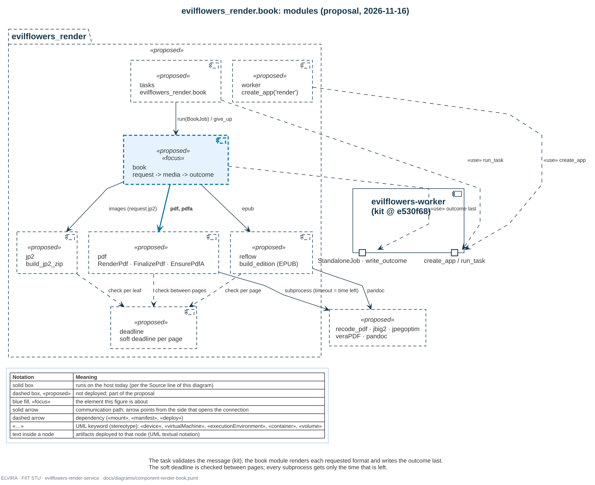
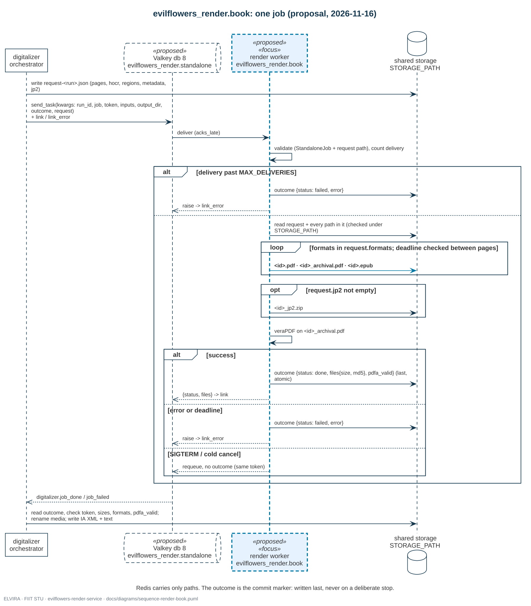

# evilflowers-render-service

Book assembly for the EvilFlowers books digitalizer. The service is one Celery task, `evilflowers_render.book`, on the
[evilflowers-worker](https://github.com/EvilFlowersCatalog/evilflowers-worker) kit. For one book it takes the
cleaned access leaves and their hOCR and produces:

| kind | file in `output_dir` | how |
|---|---|---|
| `pdf` | `<id>.pdf` | distribution copy: JPEG MRC (`recode_pdf`), outline, page labels, linearized |
| `pdfa` | `<id>_archival.pdf` | preservation master: JPEG 2000 MRC, declared PDF/A-2b, checked by veraPDF |
| `epub` | `<id>.epub` | reflow edition, steered by the operator's region decisions |
| `images` | `<id>_jp2.zip` | IA page package `<id>_jp2/<id>_%04d.jp2`, all leaves (only when `request.jp2` is set) |

It writes media only. `_hocr.html`, `_djvu.txt`, `_meta.xml`, `_scandata.xml` and `_files.xml` belong to the
orchestrator, which owns the rows. The catalog never sees this service: it receives finished PDFs.

Design: issue [#1](https://github.com/EvilFlowersCatalog/evilflowers-render-service/issues/1) and its contract comment;
the digitalizer's `docs/design/target-architecture.md` §3.




## Contract

**Message** (kwargs only): the kit's `StandaloneJob` (`run_id`, `job`, `token`, `inputs`, `output_dir`, `outcome`)
plus `request`, a JSON file next to the item. Redis carries only paths. Every path is relative to `STORAGE_PATH` and
checked to stay under it, both in the message and inside the request.

**Request** (`contract.RenderRequest`):

| field | meaning |
|---|---|
| `item_id` | the IA identifier |
| `formats` | which of `pdf`, `pdfa`, `epub` to make |
| `pages` | access leaves, in order |
| `hocr` | one hOCR file with the access leaves' pages, in the same order |
| `regions` | one list of region rows per access page, in page pixels; used by the EPUB |
| `metadata` | the item record with IA field names: XMP, PDF/A and EPUB metadata |
| `dpi` | the pages' resolution |
| `jp2` | **all** leaves, for the IA package; empty means no package |

**Outcome**, written last and atomically:

```json
{"run_id": "42", "token": "…", "status": "done", "error": null, "pdfa_valid": true,
 "files": {"pdf": {"path": "<output_dir>/<id>.pdf", "size": 12345, "md5": "…"}}}
```

- **Failure:** `status: failed` with `error` is written first, then the task raises, and Celery fires `link_error`.
  This covers a tool failing, the deadline passing, an invalid request, and the delivery cap (`MAX_DELIVERIES`).
- **SIGTERM / cold cancel** writes nothing: the redelivery carries the same token.
- **EPUB:** a failed EPUB fails the job. The digitalizer's CLI only logs it, but the orchestrator refuses an outcome
  that is missing a requested format.

## Time

A long book must finish under the task time limit. The book's own deadline, `TASK_SOFT_TIME_LIMIT` (7 h 30 min), is
checked between pages: staging, the JP2 package and both EPUB loops. `recode_pdf` assembles a whole book in one
process, so it and veraPDF get the time that is left as their timeout. The EPUB's pandoc runs have no timeout (a
verbatim port): a hung pandoc is stopped by the hard kill, without an outcome. Celery's hard kill,
`TASK_TIME_LIMIT` (7 h 50 min), sits above the deadline and below the orchestrator's 8 h deadline and the broker's
visibility timeout. The settings refuse any other order.

## Configuration

`.env.sample` lists the variables. The rest come from the kit's `RuntimeSettings`: `MAX_DELIVERIES`,
`BROKER_VISIBILITY_TIMEOUT`, `WORKER_SOFT_SHUTDOWN_TIMEOUT` and `IMAGE_TAG`.

## Development

```bash
uv sync                    # Python 3.12
uv run ruff check
uv run pytest              # tests/test_tools.py skips the tools you lack
docker build --target test .   # the suite in the image, every tool present; fails on a skip
docker build .             # the worker image
```

`tests/test_tools.py` renders a small book through the real `recode_pdf`, jbig2, jpegoptim, veraPDF, pandoc and
OpenJPEG. The other tests stub the tools and check the contract: paths, outcome, failures and the deadline.

Local worker (macOS: `--pool=solo`, see the kit's README):

```bash
uv run celery -A evilflowers_render.worker worker -E --pool=solo --queues=evilflowers_render.standalone
```

## Provenance

Ported from evilflowers-books-digitalizer at `98bf9b0`:

- `pipeline/steps/{render,finalize,pdfa}.py`, `pipeline/{profiles,pdfa,hocr}.py` → `pdf.py`, `hocr.py`;
- `reflow/` (edition, analyze, anchor, model; the LaTeX half of `vlm.py`) → `reflow/`, without the VLM;
- `studio/adapters/ia/images.py` → `jp2.py`;
- `studio/adapters/render` → `book.py`, `regions.py`, `metadata.py`.

The dual-output fix stays: JPEG layers in the distribution PDF, JPEG 2000 only in the archival master. JPEG 2000
inside the distribution PDF rendered white and slowly in viewers.

**Same behaviour, not the same bytes.**
- Same output needs the same tool versions on both sides. `pyproject.toml` keeps the digitalizer's ranges for
  archive-pdf-tools, pikepdf, Pillow and OpenCV. The image uses Debian trixie's potrace, as the digitalizer's does,
  but pandoc comes from upstream (3.13, pinned): trixie's pandoc 3.1 rejects the reflow edition's `--math-method`.
- Neither side is byte-deterministic: recode_pdf stamps dates, pandoc stamps the EPUB, and zip entries carry times.
  The digitalizer's `test_render_service` compares through a fake renderer.
